<!-- 1. HAREKETLİ DALGA & PARILTI EFEKTLİ ÜST BANNER -->
<div align="center">
  
</div>

<!-- 2. HAREKETLİ DAKTİLO TERMİNAL AKIŞI -->
<div align="center">
  <a href="https://git.io/typing-svg">
    
  </a>
</div>

<!-- 3. CANLI PROFİL SAYAÇLARI & DURUM ROZETLERİ -->
<p align="center">
  
  
  
  
</p>

<!-- HAREKETLİ NEON LAZER AYRAÇ -->


### `> whoami --verbose`

<table>
  <tr>
    <td width="62%">

```bash
kasirga@security-lab:~$ neofetch --off
       .---.        Operator   : Kadir Duyar (kasirga)
      /     \       Location   : Ankara, TR [39.93° N, 32.85° E]
      \.@-@./       Kernel     : ZeruX OS (Custom 32-bit x86)
      /`\_/`\       Hardware   : RPi 5 | ESP32 | nRF24L01 | CH341A
     //  _  \\      Red Team   : Binary Exploit, AD, Web, RE
    | \     )|_     Blue Team  : Wazuh SIEM, Sysmon, Log Analysis
   /`\_`>  <_/ \    Philosophy : "Don't just run the exploit—read the patch."
   \__/'---'\__/
```

  </td>
    <td width="38%" align="center">
      
    </td>
  </tr>
</table>

> Sistemlerin yüzeyindeki soyutlamaların altına inip **ham paketleri, bellek düzenini (memory layout), çekirdek iç yapılarını ve donanım sinyallerini** analiz ediyorum. Amacım yalnızca güvenlik açıklarını sömürmek değil; kaynak kod ve yamalar üzerinden kök nedenleri (root-cause) çözerek hem saldırı hem savunma perspektifini birleştirmek.

<!-- HAREKETLİ NEON LAZER AYRAÇ -->


### `> ls -la ./active_operations`

| Operasyon | Durum | Renk Kodu & Mimari | Teknik Kapsam |
| :--- | :---: | :--- | :--- |
| **[ZeruX OS](#)** |  | `C` · `x86 Assembly` · `FAT32` | Sıfırdan yazılmış 32-bit x86 işletim sistemi çekirdeği, RTL8139/8168 ağ sürücüleri ve TCP/IP yığını. |
| **[UAV Telemetry Lab](#)** |  | `ArduPilot` · `MAVLink` · `ESP32` | Raspberry Pi 5 ve ESP32/nRF24L01 köprüsü üzerinde MAVLink paket enjeksiyonu ve anomali tespiti. |
| **[AD & SOC Detection](#)** |  | `Windows AD` · `Wazuh` · `Sysmon` | Kerberoasting, AS-REP Roasting ve DCSync saldırılarına karşı özel SIEM korelasyon kuralları. |
| **[CyberEdu LMS](#)** |  | `React` · `TypeScript` · `Supabase` | Oyunlaştırılmış siber güvenlik farkındalık ve interaktif SCORM eğitim platformu. |

<!-- HAREKETLİ NEON LAZER AYRAÇ -->


### `> cat /etc/arsenal.conf`

#### 🟢 `[0x01] Kernel, Low-Level & Reverse Engineering`


#### 🔴 `[0x02] Red Team & Offensive Security`


-0D1117?style=for-the-badge&logo=python&logoColor=FF0055)


#### 🔵 `[0x03] Blue Team, SIEM & Threat Hunting`


#### 🟣 `[0x04] Embedded Hardware, RF & Full-Stack`


<!-- HAREKETLİ NEON LAZER AYRAÇ -->


### `> ./telemetry_monitor.sh --live`

<!-- RENKLİ AKTİVİTE DALGA GRAFİĞİ -->
<div align="center">
  
</div>

<!-- NEON İSTATİSTİK & SERİ KARTLARI -->
<div align="center">
  
  
</div>

<!-- RENKLİ BAŞARIM KUPALARI -->
<div align="center">
  
</div>

<!-- HAREKETLİ KATKI YILANI (SNAKE ANIMATION) -->
<div align="center">
  <picture>
    <source media="(prefers-color-scheme: dark)" srcset="https://raw.githubusercontent.com/kadirduyar/kadirduyar/output/github-contribution-grid-snake-dark.svg" />
    <source media="(prefers-color-scheme: light)" srcset="https://raw.githubusercontent.com/kadirduyar/kadirduyar/output/github-contribution-grid-snake.svg" />
    
  </picture>
</div>

<!-- HAREKETLİ ALT DALGA BANNER -->
<div align="center">
  
</div>
